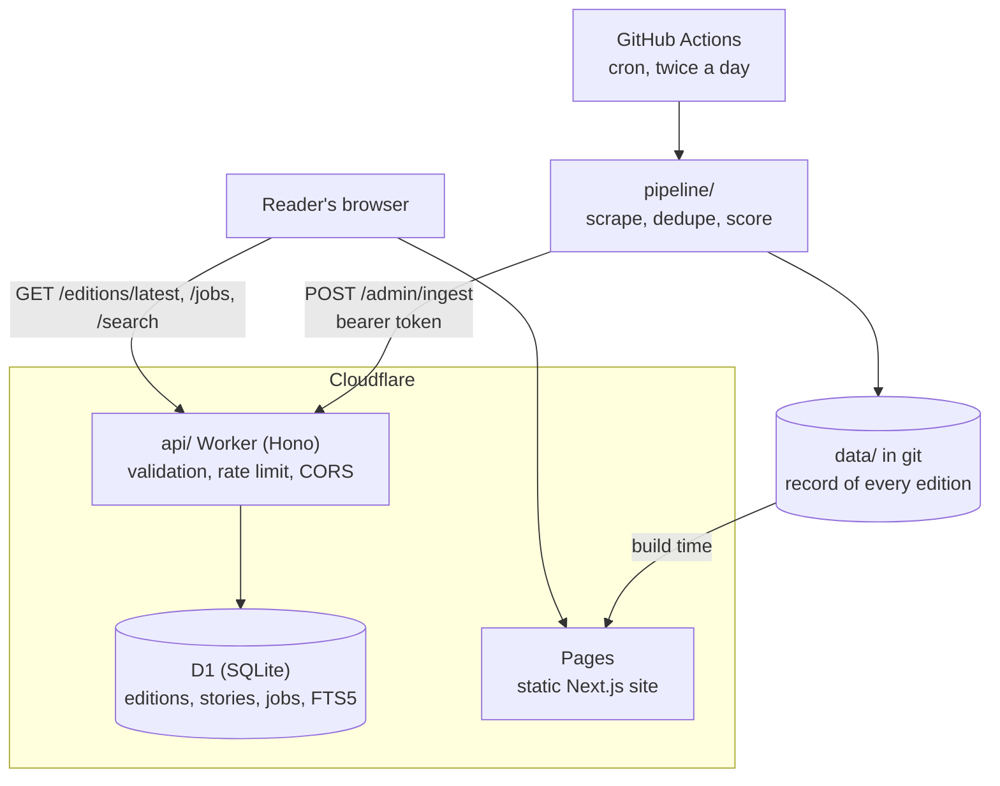

# How DevAtlas works



Three workspaces share one set of TypeScript types, so a change to a
response shape fails typecheck in every place that uses it.

## API (`api/`)

A Cloudflare Worker written with Hono, backed by D1.

| Route | Purpose |
| --- | --- |
| `GET /api/v1/health` | Database reachable, counts, newest edition. 503 while empty |
| `GET /api/v1/editions` | Editions on file, newest first |
| `GET /api/v1/editions/latest`, `/editions/:id` | One whole edition |
| `GET /api/v1/jobs` | `q`, `region`, `level`, `direct`, `page`, `limit`. Returns items, total and facet counts |
| `GET /api/v1/search` | `q`. Full-text search over stories and jobs |
| `POST /api/v1/admin/ingest` | Store an edition and replace the jobs board. Bearer token required |

- **Contract:** `api/src/contract.ts` defines every request and response. The
  frontend client and the pipeline's publish step import it.
- **Validation:** zod schemas in `api/src/validate.ts`. Bad input gets a 400
  that names the field.
- **Errors:** one shape everywhere: `{ error: { code, message, requestId } }`.
- **Rate limit:** 120 requests a minute per client address, answered with 429
  and `Retry-After`. Counters live in the Worker isolate, so the limit is per
  isolate; the store is an interface, ready for a Durable Object if needed.
- **Search:** SQLite FTS5 with prefix indexes. User text is reduced to quoted
  words before it reaches `MATCH`, so it cannot inject query syntax.
- **Ingest:** rows are unpacked in SQL with `json_each`, so 900 jobs are one
  statement. The whole ingest is one D1 batch, which is a transaction.
- **Caching:** public reads carry `Cache-Control` with `stale-while-revalidate`.
- **Tests:** `api/test/` runs the real SQL and migrations against Node's
  built-in SQLite through a small D1 stand-in. No emulator, no network.

## Pipeline (`pipeline/`)

Plain TypeScript run with `tsx`. No runtime dependencies.

| File | Job |
| --- | --- |
| `src/sources/news.ts` | Hacker News, Lobsters, DEV, RSS/Atom feeds, page descriptions and pictures |
| `src/sources/github.ts` | Rising repositories, reviewed security advisories |
| `src/sources/jobs.ts` | 92 employer boards on Greenhouse, Lever and Ashby, SimplifyJobs lists, two remote boards |
| `src/editor.ts` | Edition clock, scoring, dedupe, running order, rule-based briefing |
| `src/ai.ts` | Optional briefing from Groq or Gemini free tiers |
| `src/store.ts` | Reads and writes `data/`, prunes old editions |
| `src/publish.ts` | Sends the newest edition to the API |

Every source runs in parallel and reports for itself. A failed source is
logged in the edition and skipped. If fewer than five stories arrive the run
fails without writing, so the last good edition stays online.

`score = 100 × (0.25 + 0.75 × heat) × e^(−ageHours / 48)`

## Site (`frontend/`)

Next.js App Router with `output: 'export'`, hosted on Cloudflare Pages.

- **Front page:** painted from the edition baked in at build time, then
  `LivePaper` asks the API for the latest edition and swaps it in if a newer
  one has been printed.
- **Jobs:** search, filters, facet counts and paging all come from `GET /jobs`.
  The first page is baked in, so the board is on screen before the API answers.
- **Search:** `GET /search`, debounced, with empty and error states.
- **Footer:** a live reading from `GET /health`.

If the API is unreachable the site still shows the last printed edition.

## Data

| Where | Contents | Kept |
| --- | --- | --- |
| `data/editions/*.json` in git | One file per edition | 30 days |
| `data/jobs.json` in git | The jobs board as last printed | Replaced each run |
| D1 `editions`, `stories` | Same editions, queryable | 30 days |
| D1 `jobs`, `jobs_fts`, `stories_fts` | Jobs board and search indexes | Replaced each ingest |

## Local development

```bash
docker compose up --build
```

Or without Docker: `npm run dev:api` in one terminal (after
`npm run db:migrate:local -w @devatlas/api` and copying `api/.dev.vars.example`
to `api/.dev.vars`), `npm run dev` in another, and
`API_URL=http://localhost:8787/api/v1 ADMIN_TOKEN=dev-token npm run publish:edition`
to load the data.

CI/CD is described in [ci-cd.md](ci-cd.md).
